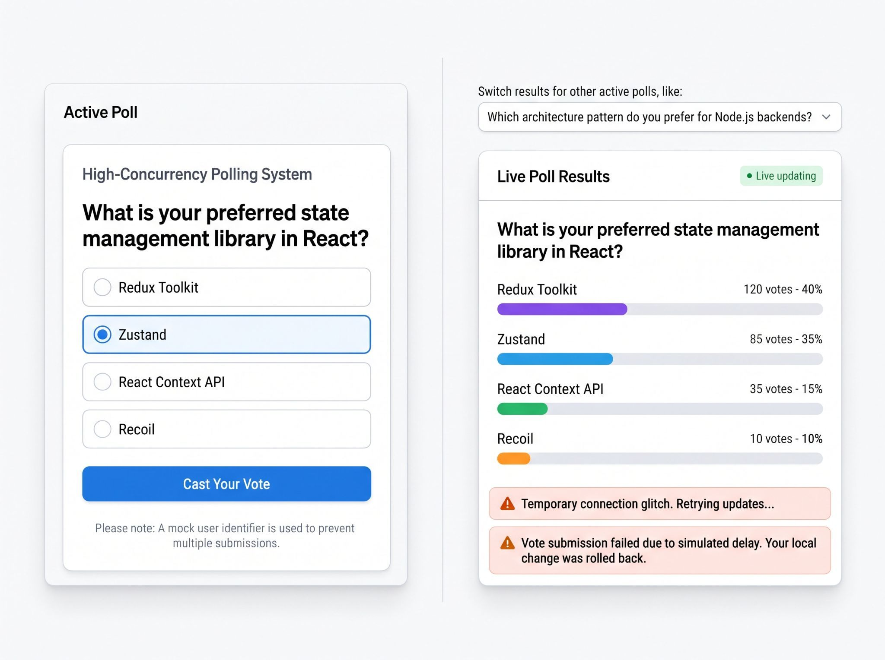

# High-Concurrency Polling System - Coding assignment

**Estimation and time cap:** 4 hours

**Objective:** Use Agentic coding ways (Opencode, Cursor etc) to build a full-stack web application using React.js and Node.js where users can vote on poll questions and view the results. While the feature set is simple, the system must be architected to handle concurrency, network instability, and strict data integrity.

## 1. Feature Requirements

### The Voting Interface (Frontend)

- Display a poll question with multiple choice answers.
- Allow the user to select an answer and submit their vote.
- The UI must feel instantaneous: implement **optimistic UI updates** when a vote is cast.

### The Results Dashboard (Frontend & Backend)

- Display the current vote counts and percentages for the poll.

- Provide a mechanism to keep the results up to date (e.g., polling, WebSockets, or Server-Sent Events).

### The API (Node.js Backend)

- Provide endpoints to fetch the active poll, submit a vote, and fetch results.
- Data can be stored in a database of your choice (SQLite, PostgreSQL, etc.) or a robust in-memory structure if properly architected for concurrent access.

## 2. Architectural & Technical Constraints

To accurately evaluate your architectural judgment and code auditing skills, your solution must address the following constraints:

- **Concurrency & Atomic Updates:** The system must accurately record every vote even if 100 users submit a vote for the exact same option at the exact same millisecond. (Avoid race conditions where read-modify-write cycles overwrite each other).
- **Resilience & Rollback:** The backend should simulate a 15% failure rate (e.g., randomly return a 500 Internal Server Error or a 3-second network delay on vote submission). Your React frontend must handle these errors gracefully by rolling back the optimistic UI state and displaying a contextual error to the user.
- **Validation:** Prevent the same user from voting multiple times on the same poll (using a simple mock user ID, session, or IP simulation). Ensure the backend strictly validates this, rather than relying solely on the frontend.

## 3. Deliverables

- **Source Code:** A Git repository containing the React frontend and Node.js backend.
- **Commit History:** Provide atomic, logical commits. We want to see how you iteratively built the application and guided your coding assistant.
- **Running application:** A full stack application that can be run locally (eg. Docker).
- **Automated Tests:** At least one test suite targeting a critical failure mode (e.g., a backend test proving race conditions are prevented, or a frontend test proving optimistic UI rollback works on API failure).
- **AGENT_WORKFLOW.md:** A brief markdown file detailing your experience using AI tools for this specific task.
  - What prompt strategy did you use?
  - What bugs, architectural flaws, or edge cases did the AI generate that you had to manually audit and fix?
